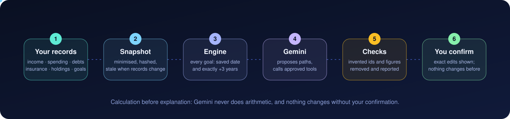
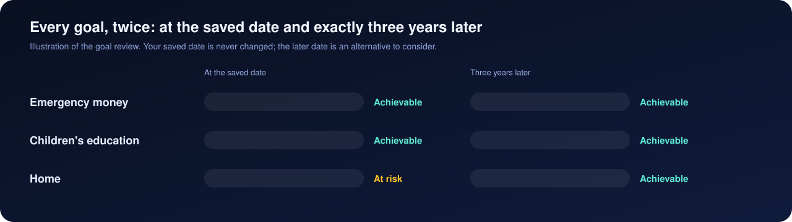
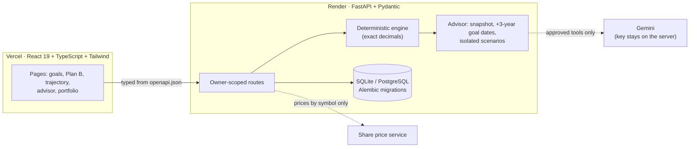

<div align="center">


<br>

[**Live site**](https://arthayukti.vercel.app) · [**Project report**](docs/PROJECT_REPORT.md) ([PDF](docs/ArthaYukti_Project_Report.pdf)) · [Financial model](docs/FINANCIAL_MODEL.md) · [AI advisor](docs/AI_ADVISOR.md) · [API](docs/API.md) · [Deployment](docs/DEPLOYMENT.md)


</div>

> **Not financial advice.** ArthaYukti works from the numbers you enter. It does not predict markets or recommend investments, and it does not model taxes beyond what a calculator states. The example households are fictional.

Built for **Srujana Hackathon 2026**, Finance track, problem **F-02: Multi-Goal Financial Planning Under Uncertainty**.

---

## What it does

When your income can't cover every goal (an emergency fund, a home, a child's education, retirement), ArthaYukti shows **which goal slips, by how long, and the smallest fix**. Every fix is re-checked by the engine before you see it.

| | |
| --- | --- |
| **Goals and trade-offs** | Put a different goal first and see what happens to the others. Smallest-fix search, plan comparison, rescue analysis with your own limits. |
| **Plan B** | Income dropped or a new cost arrived? You choose what is protected and what may change; it searches only those changes and saves your pick as a versioned Recovery Agreement. |
| **Financial Trajectory** | One monthly timeline of cash, assets, debts, insurance and the goals you choose, with a year-by-year table and net worth in today's money. |
| **AI Financial Advisor** | Reads your records, assesses **every goal at its saved date and exactly three years later**, tries alternative paths, and explains the trade-offs. Gemini words it; the engine calculates it. |
| **Income and Expenditures** | Scheduled incomes with raises and step-ups, spending plans with scheduled changes, categories and inflation. |
| **Insurance, Debts, Equities** | Policies and premiums, loan repayment and prepayment effects, an investment calculator, a holdings ledger and an Indian stock portfolio tracker. |
| **Emergency Funds and Alerts** | A reserve target in months of essential spending, progress, and renewal reminders. |

English and हिन्दी throughout, light and dark themes, and a **Listen** option that reads a page aloud.

## The AI Financial Advisor

<p align="center"></p>

<p align="center"></p>

```
 your records ──► snapshot (hashed) ──► engine: every goal at its date and +3 years
                                                │
              Gemini proposes paths ──► approved scenario tools ──► engine calculates
                                                │
                  checked: invented ids, unsupported figures, contradictions removed
                                                │
                  you compare, then accept ──► you confirm the exact edits ──► plan updated
```

- **Calculation before explanation.** Gemini never does arithmetic; every figure comes from the engine.
- **Your saved goal dates are never changed.** The later date is only an alternative to consider.
- **Nothing changes without you.** Accepting shows the exact edits; they apply only on a second, explicit confirmation.
- **Stale advice is flagged.** Change income, spending, debts or goals and the analysis says it is out of date.
- **It works without AI too.** With no key, the engine still finds and ranks paths and writes the report.
- **The key stays on the server.** It is never sent to the browser, logged or put in a prompt.

Details: [docs/AI_ADVISOR.md](docs/AI_ADVISOR.md).

## Screenshots

| | |
| --- | --- |
|  |  |
|  |  |
|  |  |

## Try it

1. Open the [live site](https://arthayukti.vercel.app) and choose **Look at an example household**. Nothing you do is saved.
2. Or **Create an account**, then add numbers in any order, or use the three-step guided setup (money in, money out, goals).
3. Open **AI advisor** and choose **Analyse my finances**.

## Run it on your computer

You need **Python 3.12**, **Node 22 or newer**, and `make`. Dependencies are pinned in [`backend/pyproject.toml`](backend/pyproject.toml) and [`frontend/package.json`](frontend/package.json) (with `package-lock.json`); `make setup` installs both.

```bash
make setup      # virtualenv, backend and frontend dependencies
make dev-api    # API on http://127.0.0.1:8000
make dev-web    # app on http://localhost:5173 (second terminal)
```

```bash
make check      # lint, types and tests for both halves
make gen-api    # regenerate contracts/openapi.json and the frontend types
```

On Windows, `make setup` uses `py -3.12`; override with `make setup BOOTSTRAP_PYTHON="path/to/python.exe"`.

### Configuration

Copy `.env.example` to `backend/.env`. The defaults work locally (SQLite, a temporary signing key). Never commit the real `.env`.

| Setting | Purpose |
| --- | --- |
| `DATABASE_URL` | SQLite by default; PostgreSQL for a real deployment. Run `cd backend && alembic upgrade head`. |
| `SECRET_KEY` | Required outside development: at least 32 random characters. |
| `ALLOWED_ORIGINS` | Web addresses allowed to call the API. |
| `GEMINI_API_KEY` | Optional. Turns on AI wording in the advisor and Plan B. Backend only. |
| `MARKET_PROVIDER` | Optional. `yahoo` reads live Indian share prices; the default uses the configured price service. |

The frontend reads `VITE_API_BASE_URL` when the API is on another address.

## Architecture



## How it is built

```
backend/     FastAPI + Pydantic + SQLAlchemy/Alembic; the calculation engine lives in app/engine
frontend/    React 19, TypeScript, Vite, Tailwind; English and Hindi copy; generated API client types
contracts/   openapi.json (generated, checked by a test) and sample plans
docs/        financial model, API, Plan B, AI, trajectory, modules, deployment, readiness
```

- The engine is plain, deterministic Python on exact decimals; the API and screens only present its results.
- The API contract is generated from the backend, checked by a test, and the frontend types are generated from it.
- Deployed from `main`: the API on **Render**, the site on **Vercel**.

## What you can trust

- **Reproducible.** No randomness, no black-box model.
- **Written rules.** [Financial model](docs/FINANCIAL_MODEL.md), [Plan B](docs/PLAN_B.md), [Trajectory](docs/FINANCIAL_TRAJECTORY.md). Tests include hand-checked cases and checks that money is conserved every month.
- **Exact money.** Decimals, never floating point.
- **Visible assumptions.** Interest, inflation, growth and returns are explicit inputs; nothing is assumed silently.
- **Unknown stays unknown.** A missing price or balance is shown as unavailable, never as zero.

## Tests

`make check` runs everything: **1,132 backend tests** and **390 frontend tests** pass, with ruff, TypeScript, oxlint and the production build clean. Highlights: `tests/engine/test_golden.py` (hand-checked cases written before the engine), `test_projection.py` (shocks and seeded random plans), `test_trajectory_engine.py` (accounting invariants), `test_advisor_engine.py` and `tests/api/test_advisor_api.py` (goal dates, scenarios, model-output checks, ownership). All AI calls in the suite are faked; a live check is opt-in (`RUN_LIVE_GEMINI=1`).

## Known limits

- Hindi text is a first draft awaiting a native reader, and some server-written sentences are English only.
- The price service is unofficial and can be delayed or unavailable; the app then shows the last price with its age, never zero.
- On the hosted demo, saved data may be wiped when the server restarts until a permanent database is connected ([deployment](docs/DEPLOYMENT.md), [readiness](docs/PRODUCTION_READINESS.md)).
- Advisor debt paths don't show how goals change, and spending cuts need lines marked optional in the plan.

## Repository layout

```
backend/     FastAPI app, calculation engine, Alembic migrations, tests
frontend/    React app, English and Hindi copy, generated API types, tests
contracts/   openapi.json (generated) and sample plans
docs/        guides and module notes; spec/ (specification), reports/ (audits and history), assets/ (README graphics)
render.yaml  Render blueprint for the API       Makefile  common tasks
```

## More documentation

Start at the [documentation index](docs/README.md): [financial model](docs/FINANCIAL_MODEL.md) · [Plan B](docs/PLAN_B.md) · [AI advisor](docs/AI_ADVISOR.md) · [trajectory](docs/FINANCIAL_TRAJECTORY.md) · [stock portfolio](docs/STOCK_PORTFOLIO.md) · [API](docs/API.md) · [deployment](docs/DEPLOYMENT.md).

## Disclaimer

Illustrative decision support under the user's own assumptions. Not financial advice. Sample households are fictional.
