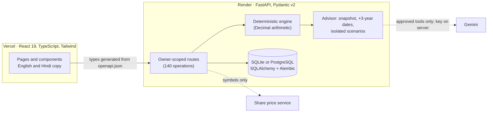
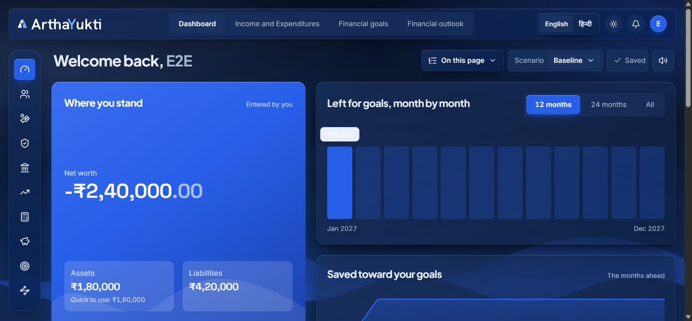
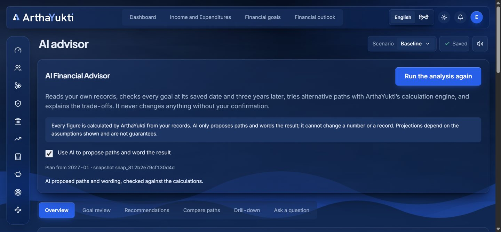
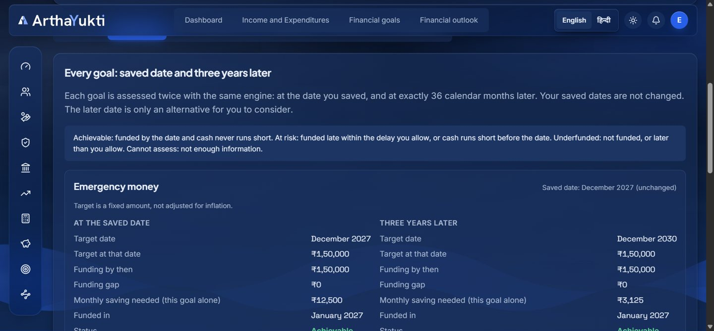
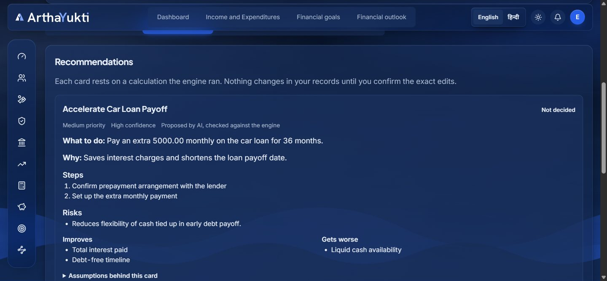
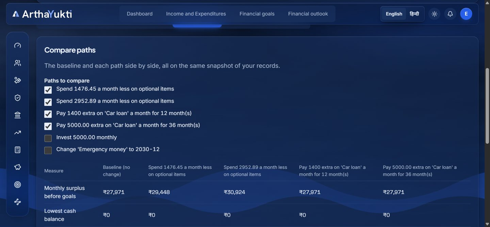
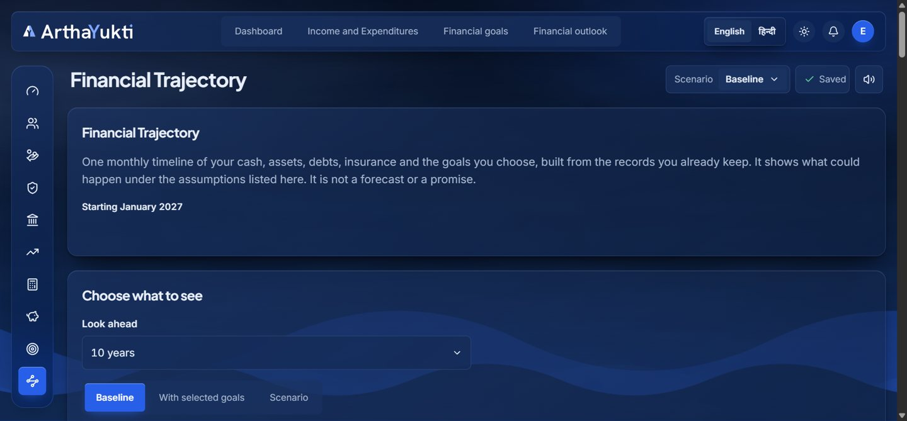
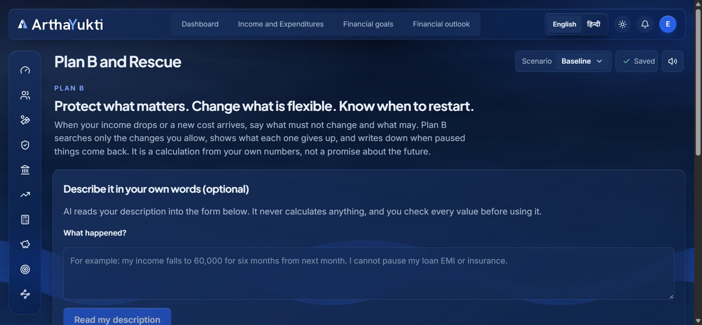

# ArthaYukti: Project Report

**Srujana Hackathon 2026 · Finance · Problem F-02: Multi-Goal Financial Planning Under Uncertainty**

Repository: <https://github.com/Samudra-GITHub/arthayukti> · Live site: <https://arthayukti.vercel.app> · Written 26 October 2026

> This report separates what is **demonstrated and tested** from what is **partial or planned**. Section 11 lists every limit, including the state of the hosted deployment (11.1). The advisor's end-to-end run and the screenshots are from a local run; the hosted API's health and routes were checked directly.

---

## 1. Project overview

| | |
| --- | --- |
| **Title** | ArthaYukti: *see which goal you lose when money runs short, and the smallest change that fixes it* |
| **Theme / problem** | Finance, F-02: Multi-Goal Financial Planning Under Uncertainty |
| **Team** | **Medhavi** (members in section 15) |

**Executive summary.** People rarely have one financial goal. They want an emergency fund, a child's education, a home and retirement at once, from one income that can shrink. ArthaYukti is a web application that takes a household's income, spending, debts, insurance, investments and goals and answers three questions with exact, reproducible calculations: *which goal slips and by how long*, *what is the smallest change that fixes it*, and *what happens if life goes wrong* (income drop, new cost). On top of the engine sits an **AI Financial Advisor** (Gemini) that proposes alternative paths and explains trade-offs, but never does the arithmetic and never changes a record without the person confirming the exact edit.

## 2. Problem understanding

- **Target users:** individuals and households in India planning several money goals from one income, including households with irregular or reducing income. The interface is in **English and Hindi**.
- **Pain points:** goals compete for the same surplus and a calculator for each goal in isolation double-counts money; people cannot see *which* goal loses; a shock (job loss, medical bill) invalidates the plan and nobody knows what to protect; advice tools either give generic tips or hide their arithmetic.
- **Why it matters:** the failure is silent. A plan that looks fine goal by goal can be impossible in total.
- **Assumptions we made explicit:** every rate (inflation, savings return, income and expense growth) is a user input, never a hidden default; money is in rupees and exact; a goal's target is either a fixed amount or an amount in today's money raised by a stated inflation rate.
- **Needs addressed:** trade-off visibility (which goal loses), smallest feasible fix, shock handling that respects what the person says is protected, honesty about missing data, and no black-box advice.

## 3. Proposed solution

**Core journey:** enter income and spending → add goals with amounts, dates and priority → the **Dashboard** shows each goal as on time or late → explore **trade-offs** (change priorities), **what-if** (income drop, surprise expense), **smallest fixes**, **rescue analysis** (your own limits) → if life changes, use **Plan B** → look ahead with the **Financial Trajectory** → ask the **AI Financial Advisor** for a full review.

Main areas (all implemented): User Profile · Income and Expenditures (scheduled incomes with raises and step-ups; spending plans with scheduled changes and inflation) · Insurance · Debts (loan calculator, prepayment effect) · Equities (investment calculator, holdings ledger, Indian stock portfolio tracker) · Emergency Funds · Financial goals · Financial Trajectory · Financial outlook · Plan B and Rescue · AI advisor · Alerts · Settings.

## 4. Innovation and differentiation

1. **Goals compete for one surplus, explicitly.** A deterministic allocation policy (priority order, level required contribution first, then top-up) means money is never counted twice and the loser is visible. It is not a collection of per-goal calculators.
2. **Plan B: the person decides what is protected.** The search only touches changes the person allowed, reports up to three plans with what each gives up, and distinguishes *no plan works* from *the search did not finish*. A saved **Recovery Agreement** has versions and return-to-normal conditions; a date alone never restores anything.
3. **Every goal at its saved date and exactly three years later.** The advisor assesses each goal twice with the same engine (the later date is a separate run with the goal's date overridden, never a copy), re-allocates competing goals and reports the effect on the others. The saved date is never edited.
4. **Calculation before explanation.** Gemini can only call approved, validated scenario tools; the engine returns the numbers; the model's output is then checked (invented scenario ids, unsupported figures, contradictions are removed and reported on screen). If the model fails or is switched off, the engine still produces paths and the report.
5. **Nothing changes without exact confirmation.** Accepting a recommendation shows the exact edits and a confirmation token (a hash of those edits and the data snapshot); only repeating the request with that token applies them, and only if nothing changed meanwhile. Editing records marks the analysis *stale*.
6. **Honesty about unknowns.** A missing price or balance is shown as unavailable, never zero; a failed price fetch never becomes a zero price.

## 5. System architecture



- **Data flow (advisor):** records → minimised snapshot (hashed; no name, e-mail, phone, account name or policy number) → baseline trajectory → goal assessments at saved date and +36 months → engine-found paths → optional Gemini loop (3 rounds, 4 calls per round, 10 in total) → output checks → stored analysis → UI.
- **API:** 109 paths, 140 operations, 289 schemas. The contract `contracts/openapi.json` is generated from the backend, a test fails if it is out of date, and the frontend types are generated from it.
- **Database:** SQLAlchemy models with 12 Alembic migrations (SQLite locally, PostgreSQL in deployment). Plans are JSON documents in `saved_plans`; the advisor adds `advisor_analyses`, `advisor_scenarios` and `advisor_decisions` (references, results and a snapshot hash; never the API key, prompt or raw model reply).
- **Stack:** Python 3.12, FastAPI, Pydantic v2, SQLAlchemy, Alembic, PyJWT, bcrypt; React 19, TypeScript, Vite, Tailwind CSS, lucide-react; vitest and pytest; ruff and oxlint; Render and Vercel.

## 6. Implementation details

**Engine (`backend/app/engine`, plain Python on `Decimal`, no floats, no randomness).**
- *Goal allocation* (`projection.py`): each month, surplus pays each goal's **level required contribution** in priority order, then tops up; deficits draw from free cash then from goals (emergency fund first); a goal is funded when its balance reaches the (inflated) target. Reports status (on track, delayed, not achievable), shortfall, delay and who crowded whom out.
- *Trajectory* (`trajectory.py`): an event ledger of income, spending, debt (principal and interest through the loan amortisation engine), insurance premiums and maturities, investments, deposits and goal effects; contributions are transfers, never a second expense; every year reconciles to its events.
- *Plan B* (`recovery_*`): month-by-month evaluation under a disruption, a bounded search over only the allowed adjustments, restoration conditions, review against current figures, versioned agreements.
- *Advisor engine* (`advisor.py`): `plus_three_years_month/date` (36 calendar months; a non-existent day such as 29 February becomes the month's last day), goal assessment with explicit status criteria, scenario builders (optional-spending cut, extra investment, goal date/amount change, extra loan payment, assumption change), feasibility checks (cash shortfall, collateral damage to other goals), metric comparison.
- *Calculators, income, expenditure, portfolio:* amortisation, investment growth with tax method and rate convention, scheduled income and spending, FIFO holdings ledger with fees and dividends.

**Advisor service (`backend/app/api/advisor.py`, `app/ai/advisor.py`).** Snapshot and hash, staleness check, isolated scenarios, bounded Gemini loop, validation of the model's report, decisions with the confirm-before-edit token, rate limits per person.

**Frontend.** Hash-routed React app; a custom accessible `Select`; bilingual copy hooks per module; the advisor page has Overview, Goal review, Recommendations, Compare paths, Drill-down and Ask tabs.

**Key decisions.** Exact decimals and generated API contract; the engine is the single source of numbers; AI is optional and sandboxed; additive-only migrations; ownership checks on every record.

## 7. Achievements during the hackathon

Built and working locally: the full list in section 3, with a measurable footprint of about **20,600 lines of backend** and **26,900 lines of frontend** (non-test TypeScript), **140 API operations**, **12 migrations**, **87 test files**, **1,132 backend tests and 390 frontend tests passing**. Final-stretch milestones: Financial Trajectory with year-by-year table and inflation-adjusted net worth; Expenditure plans connected to goals and trajectory; Indian stock portfolio with live prices (Yahoo mode, verified live: three symbols priced on the last close, an unknown symbol correctly priced as none); the **AI Financial Advisor** with the +3-year goal assessment, five isolated scenario tools, comparison, decisions and follow-up chat.

## 8. Testing and validation

- **Backend (1,132 pass, 1 opt-in live test skipped).** Hand-checked golden cases written before the engine; property-style tests on seeded random plans (money conserved every month, balances never negative, deterministic, extra savings never delay a goal); trajectory accounting invariants; API tests for ownership, validation and error shapes; migration tests (up, matches models, down).
- **Advisor-specific** (`tests/engine/test_advisor_engine.py`, `tests/api/test_advisor_api.py`): hand-checked example (income 100,000, rent 40,000, optional 10,000, goal 700,000 in 12 months: available by the date 600,000, gap 100,000, funded in month 14, two months late; three years later achievable with a lower level contribution); a 10% optional cut saves exactly 1,000 a month and shrinks the gap from 100,000 to 88,000; an investment is a transfer (net worth unchanged) and is infeasible if cash runs short; zero-interest debt prepayment pays off in 6 months instead of 12; date edge cases (29 February, month ends); every goal gets both assessments; saved plan untouched; another user's analysis, scenario, compare, chat and decision are all 404; changed records mark the analysis stale and block new scenarios; decisions change nothing until the exact confirmation; model output with invented ids, unsupported figures, wrong-kind or rejected paths is removed and reported; provider timeout, rate limit, outage and malformed output leave the engine report intact; the API key never appears in a response or prompt; prompt injection in a goal label is carried as data.
- **Frontend (390 pass):** page tests with a mocked API for each advisor tab, the confirmation flow, stale state, failure states, unknown values shown as dashes; plus tests for every other page.
- **Static checks:** ruff, TypeScript, oxlint and the production build are clean.
- **Live end-to-end run (local):** a scratch account with the sample "stretched family" plan (three goals), a ₹1,80,000 account, a car loan and a profile. Baseline: 2 of 3 goals achievable; Home at risk with a ₹4,48,958 gap, funded 15 months late; moving Home three years later makes it achievable. Spending cuts of 5% and 10% reduce the gap to ₹3,22,958 and ₹1,96,958. With the real Gemini key, the model asked the engine to test cutting optional spending by ₹12,471.06 a month for 60 months (closes the gap) and ₹5,500 for 36 months (partial), and in follow-up chat ran the three-year delay for all three goals and explained them; the figures it quoted matched the engine. One live run had a figure removed by the output checks, which is the safeguard working. Accepting a recommendation listed the exact edits; the plan stayed unchanged until Confirm, after which the two expense lines changed and the analysis showed as out of date.
- **Known failures / not tested:** see section 11.

## 9. AI, data and external dependencies

- **AI used to build the project:** Claude Code (Anthropic) was used throughout for design, implementation, tests and review; every change was verified by the automated suite and by running the app.
- **AI in the product:** Google Gemini (`gemini-3.5-flash-lite`, configurable) via a single HTTPS call from the backend (no SDK). Two features: Plan B (describe a situation into a form draft; plain-language explanation of a plan) and the Advisor (propose paths through approved tools; word the result). **Prompts** are in `backend/app/ai/advisor.py` and `backend/app/ai/assist.py`. The system prompt forbids calculating, inventing figures or ids, and treats labels as data. The key is server-side only and never logged, returned or placed in a prompt.
- **Data:** no external datasets. Sample households in `contracts/samples/` are fictional. Share prices come from an unofficial Yahoo Finance reader (Yahoo mode) or a configured price service; they are for planning, can be delayed, and carry their own terms.
- **Libraries:** FastAPI, Pydantic, SQLAlchemy, Alembic, PyJWT, bcrypt, psycopg, uvicorn; React, Vite, Tailwind, lucide-react, Fontsource fonts (Inter, Plus Jakarta Sans, Space Grotesk, Noto Sans Devanagari); pytest, vitest, ruff, oxlint, openapi-typescript. Hosting: Render and Vercel.

## 10. User interface and demonstration

| | |
| --- | --- |
|  |  |
| Dashboard: where you stand, each goal on time or late | Advisor overview: findings, headline figures, data quality |
|  |  |
| Every goal at its saved date and three years later | Recommendation cards with risks and trade-offs |
|  |  |
| Baseline and paths side by side | Financial Trajectory |
|  | |
| Plan B: protect what matters, change what is flexible | |

**Demo path (about three minutes).** Open the site → *Look at an example household* (nothing saved) → see which goal is late → *Create an account* → add the sample goals → open **AI advisor** → *Analyse my finances* → *Goal review* (each goal twice) → *Recommendations* → *Accept* to see the exact edits (nothing changes yet) → *Compare paths* → *Ask a question* ("What if I reduce discretionary spending by 5%?"). Short screen-reader-friendly text accompanies every status; status is never shown by colour alone.

## 11. Limitations and incomplete work

1. **Hosted deployment.** The Render API is live at `https://arthayukti-api-y7ah.onrender.com` (its deploy log shows all 12 migrations including the advisor's applied, a clean start and passing health checks; its OpenAPI lists the 8 advisor routes and its CORS allows the Vercel site). The Vercel site had been built with an older API address that no longer answers, so the hosted site could not reach the API; the frontend now maps that old address to the live one, which takes effect when Vercel redeploys from `main`. Render's free plan sleeps when idle, so the first request after a pause can take a minute. The hosted advisor uses Gemini only if `GEMINI_API_KEY` is set in Render's dashboard; otherwise it runs engine-only and says so.
2. Hindi text is a first draft awaiting a native reader; server-written advisor sentences are English unless Gemini is asked for Hindi.
3. Advisor limits: debt paths do not model how goals change; spending cuts need lines marked optional (when spending comes from Expenditure plans the advisor says it cannot tell which part is optional); no income-change tool; retirement is assessed only on the saving side (retirement period and spending are not modelled, and the card says so); applying an accepted spending cut edits the plan's lines for every month, not only the months modelled.
4. No probability of success is given: there is no validated probability model, and no Monte Carlo.
5. The price service is unofficial; when unreachable the app shows the last price with its age, never zero. The original published provider address was not reachable.
6. On the free hosted tier saved data may be wiped on restart until a permanent database is attached. Rate limiting is in-process (per server instance).
7. No taxes are modelled beyond what a calculator states; no bank linking; no transactions are executed.
8. Plan B reviews rebuild the past from the saved plan; they cannot take real past figures.
9. Automated Gemini tests use a fake client; the live check was run once by hand (opt-in test), and model wording varies per run.
10. A local development database from earlier work has schema drift unrelated to the migrations; fresh databases built from the migrations match the models.

## 12. Real-world viability and impact

- **Users and benefit:** households planning several goals who want an explanation they can check, in their own language, including the trade-off they would otherwise discover too late.
- **Feasibility and scale:** a stateless API over a relational database; the engine is pure and cheap (a full advisor analysis runs a few dozen deterministic projections); the heaviest cost is the optional model call, which is bounded (10 calls). Moving to PostgreSQL and a shared rate-limit store (for example Redis) is the main scaling step.
- **Security and privacy:** JWT sign-in with bcrypt, owner-scoped queries, validated inputs, request size limits, no secrets in the frontend, minimised model payloads (no name, e-mail, phone, account or policy identifiers), labels treated as untrusted data, audit-friendly stored references.
- **Risks and legal limits:** projections depend on assumptions and are not guarantees; this is decision support, not licensed investment, tax or legal advice; price data is unofficial. Any production use would need a compliance review, a privacy notice and a permanent database with backups.

## 13. Future scope

Native-reader review of Hindi and more languages; an income-change and goal-effect model for debt paths; retirement decumulation (years in retirement and spending needs); a validated probability model (clearly labelled) and stress tests; account aggregation with consent; shared household accounts; PDF export of the advisor report; shared rate limiting, backups and monitoring for real deployment; user research with real households.

## 14. Setup and reproducibility

Requirements: Python 3.12, Node 22 or newer, `make`.

```bash
make setup      # virtualenv plus backend and frontend dependencies
make dev-api    # API on http://127.0.0.1:8000
make dev-web    # app on http://localhost:5173
make check      # lint, types and tests for both halves
```

Environment (copy `.env.example` to `backend/.env`; never commit it): `DATABASE_URL` (SQLite by default), `SECRET_KEY` (required outside development), `ALLOWED_ORIGINS`, optional `GEMINI_API_KEY` and `GEMINI_MODEL`, optional `MARKET_PROVIDER`. Schema: `cd backend && alembic upgrade head`. Optional live AI check: `RUN_LIVE_GEMINI=1 pytest tests/test_advisor_live.py`. **Demo data:** choose *Look at an example household* on the site, or load `contracts/samples/*.json`. There are no shared test credentials; create your own account locally.

## 15. Team contributions and references

**Team statement:** ArthaYukti was built by Team Medhavi, two co-builders who share the project equally.

| Member | Role | What they brought |
| --- | --- | --- |
| **Samudra Kar** | Co-builder: engineering and integration | Product direction; backend and frontend implementation; bringing the team's work into one code line; testing; deployment; AI-assisted development with Claude Code. |
| **Shankara Vasishta** | Co-builder: features, fixes and review | Feature work and code fixes developed in a separate working copy and merged into the main code line; review of behaviour against the problem statement. |

Commit counts in the repository do not measure who contributed what: the second member's work was merged and committed through one account, and the history shows a single shared code line. A further teammate contributed the development-database sign-in fallback, which was hardened and tested before merging.

- **References:** [Indian-Stock-Market-API](https://github.com/0xramm/Indian-Stock-Market-API) (MIT; price endpoints studied and its unofficial Yahoo Finance basis documented in `docs/STOCK_PORTFOLIO.md`); Google Gemini API documentation; FastAPI, Pydantic, SQLAlchemy, React and Tailwind documentation.
- **Further reading in the repository:** [financial model](FINANCIAL_MODEL.md) · [Plan B](PLAN_B.md) · [trajectory](FINANCIAL_TRAJECTORY.md) · [AI advisor](AI_ADVISOR.md) · [API](API.md) · [deployment](DEPLOYMENT.md) · [audits and history](reports/).
